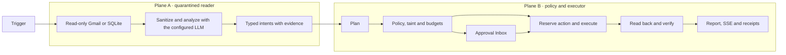

# Agentware Track 1 · Inbox & Calendar

Siftvane runs inbox playbooks, verifies each mutation against its target, and exposes the policy decision and action receipt.

The six run stages are `TRIGGER → PLAN → POLICY → ACT → CHECK → REPORT`. Plane A reads a bounded mailbox window and earlier thread messages, filters hostile or security-sensitive content, then asks the configured LLM for structured intents, priority, evidence, planning guidance, and reply drafts. `apps/server/src/inbox/model.ts` validates the response with Zod. The model request has no tool bindings. `apps/server/src/inbox/reader.ts` verifies evidence, derives sender and destination provenance from the source, and downgrades unsupported fields. Plane B converts intents to bounded playbook actions, applies policy, reserves writes in SQLite, and verifies their read-back.

Gmail uses a recent-message window plus bounded earlier messages from the selected threads. Follow-up cancellation accepts a verified related response, including another thread linked through message references or the same normalized subject. The sandbox has 20 primary messages and three earlier thread records. `offline-smoke` uses the deterministic parser and makes no model calls.

Google sign-in establishes the operator session. Incremental OAuth connects a separate `gmail_oauth` inbox with the scopes returned by Google. The selected inbox determines the reader, policy, approvals, schedule, and journal. The scoped MCP tools use the same inbox executor for changes. [Google setup and scopes](README.md#connect-google-gmail-and-calendar)

## Playbook registry

The registry in `apps/server/src/inbox/playbooks/index.ts` declares trigger, autonomy tiers, policy rules, verification, rollback, and budget costs.

| Playbook | Effect |
| --- | --- |
| `travel_delay_cascade` | Update a matched flight, move a free flexible solo block, notify allowlisted attendees, and queue external changes. |
| `autonomous_meeting_scheduler` | Resolve explicit time offsets, reserve a 15-minute prep block, and confirm qualifying bookings. |
| `bills_trials_spoof_guard` | Record invoices and renewal reminders, flag changes or duplicates, and queue editable review drafts. |
| `hostile_input_quarantine` | Read, classify, and quarantine suspected messages. A burst halts before actions execute. |
| `pre_meeting_dossier` | Attach relevant thread references, commitments, and filenames to matched meetings. |
| `commitment_radar_and_chaser` | Track deadlines, isolate conflicts, and follow up with permitted contacts. |
| `order_delivery_tracker` | Reconcile tracking updates and keep a return deadline. |
| `ephemeral_otp_expiry` | Archive aged one-time-code messages. Password-reset and security notices are exempt. |
| `newsletter_outreach_rollup` | Group newsletter metadata and remove unsolicited outreach from the inbox. |

## Tool permission matrix

| Action | Reader | Executor |
| --- | --- | --- |
| Parse message/body/attachment | Read-only | Receives typed intent |
| Read calendar or write target | — | Read before dispatch and after mutation |
| Calendar, labels, and tracking records | — | Tier 0/1 if reversible and within policy |
| Send mail | — | Tier 1 only for allowlisted recipients and bounded content, or Tier 2 after approval |
| External calendar mutations or billing reply drafts | — | Tier 2 with a recorded approval |
| Tainted destinations and forbidden content | — | Blocked independently of approval |
| Restore earlier state | — | Explicit operator rollback, guarded by current state and halt status |

Live Calendar uses a managed event’s private properties `siftvaneKind`, `siftvaneFlexible`, `siftvaneBooking`, and `siftvaneDomain` to recognize flights and flexible blocks. Writes use read-back verification. Dataset facts and billing conflicts come from the inbox and prior ledger state. Inbox live mail mutation goes through the policy-gated executor.

## Model configuration

`SIFTVANE_AGENT_MODE=llm` uses Gemini, OpenAI, Anthropic, Groq, or Ollama. With a key or Ollama endpoint configured, LLM mode is selected by default. The recommended model is `gemini-3.1-flash-lite`. The executor never grants the model write tools, recipient selection, credentials, or control of the final policy disposition.

`SIFTVANE_AGENT_MODE=offline-smoke` selects deterministic inference explicitly. The Compose sandbox uses this setting. Each model-call PLAN event carries provider, model, prompt tokens, completion tokens, latency, and estimated USD. The REPORT event and the JSON envelope carry the aggregate. Invalid schema, missing IDs, or a transport failure stops the run without a silent fallback.

Use `pnpm test:adversarial` for the built-in regression suite and `pnpm run-official-trap-pack PATH` for a separately supplied pack. The latter defaults to an isolated offline-smoke run and retains case traces, including degraded or failed cases.
