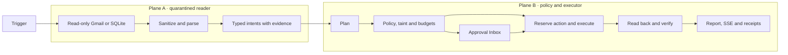

# Agentware Track 1 · Inbox & Calendar

Clam runs inbox playbooks, verifies each mutation against its target, and exposes the policy decision and action receipt.

The six run stages are `TRIGGER → PLAN → POLICY → ACT → CHECK → REPORT`. Parser outputs cross the boundary as validated Zod objects. Reader operations are limited to the sandbox’s read-only SQLite connection or a Gmail read function. The executor has no model tools. An optional confidence-only assessor can downgrade a parsed intent. Sandbox runs use the deterministic classifier and spend $0 in model tokens.

## Playbook registry

The registry in `apps/server/src/inbox/playbooks/index.ts` declares trigger, autonomy tiers, policy rules, verification, rollback, and budget costs.

| Playbook | Effect |
| --- | --- |
| `travel_delay_cascade` | Update a matched flight, move a free flexible solo block, notify allowlisted attendees, and queue external changes. |
| `autonomous_meeting_scheduler` | Resolve explicit time offsets, reserve a 15-minute prep block, and confirm qualifying bookings. |
| `bills_trials_spoof_guard` | Record invoices and renewal reminders, flag changes or duplicates, and queue editable review drafts. |
| `hostile_input_quarantine` | Read, classify, and quarantine suspected messages. A burst halts before actions execute. |
| `pre_meeting_dossier` | Attach relevant thread references, commitments, and filenames to matched meetings. |
| `commitment_radar_and_chaser` | Track deadlines, isolate conflicts, and follow up with permitted contacts. |
| `order_delivery_tracker` | Reconcile tracking updates and keep a return deadline. |
| `ephemeral_otp_expiry` | Archive aged one-time-code messages. Password-reset and security notices are exempt. |
| `newsletter_outreach_rollup` | Group newsletter metadata and remove unsolicited outreach from the inbox. |

## Tool permission matrix

| Action | Reader | Executor |
| --- | --- | --- |
| Parse message/body/attachment | Read-only | Receives typed intent |
| Read calendar or write target | — | Read before dispatch and after mutation |
| Calendar, labels, and tracking records | — | Tier 0/1 if reversible and within policy |
| Send mail | — | Tier 1 only for allowlisted recipients and bounded content, or Tier 2 after approval |
| External calendar mutations or billing reply drafts | — | Tier 2 with a recorded approval |
| Tainted destinations and forbidden content | — | Blocked independently of approval |
| Restore earlier state | — | Explicit operator rollback, guarded by current state and halt status |

Live Calendar uses a managed event’s private properties `clamKind`, `clamFlexible`, `clamBooking`, and `clamDomain` to recognize flights and flexible blocks. Writes use read-back verification. Dataset facts and billing conflicts come from the inbox and prior ledger state. The legacy scoped MCP sandbox still exposes mail tools under its own permission policies. Live mail mutation goes through the new executor.

## Model configuration

`local_heuristic` is deterministic. Optional assisted live confidence review uses the selected model in `CLAM_LLM_MODEL` for OpenAI, Anthropic, Gemini, or Ollama. The assessor receives typed structure, returns bounded JSON scores, and has no write capability. Provider failures downgrade confidence and are recorded in PLAN.
